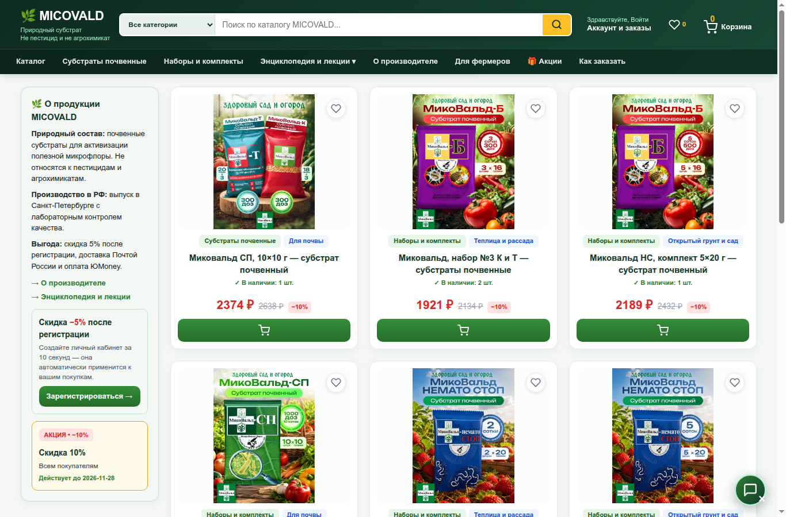
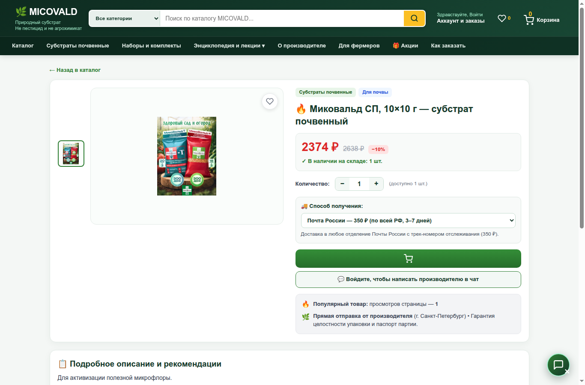
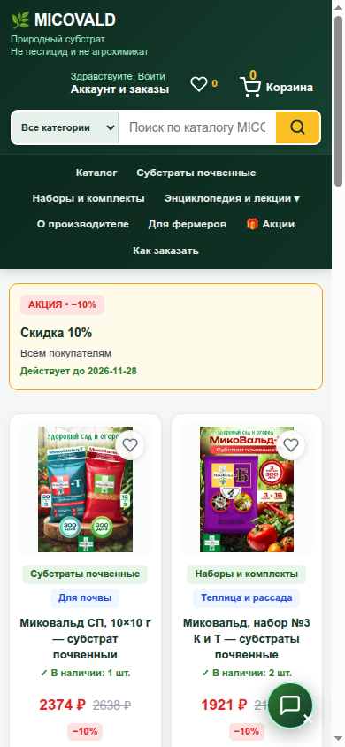
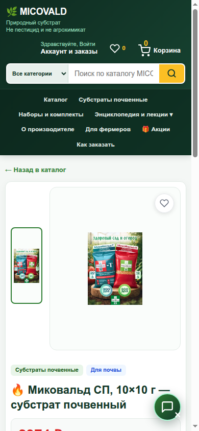

# 🌿 MICOVALD — Full-Stack E-commerce платформа для производителя биосубстратов

Полнофункциональный интернет-магазин и система управления продажами для российского производителя почвенных субстратов **MICOVALD (г. Санкт-Петербург)** на стеке **Python (FastAPI) + Caddy HTTPS + Docker**.

## 🎬 Видеодемонстрация работы платформы
- [Смотреть / скачать видео работы сайта (MP4)](docs/video/demo_micovald.mp4) *(после загрузки на GitHub можно также перетащить файл `demo_micovald.mp4` прямо в это поле при редактировании `README.md` для встроенного плеера)*.

## 📸 Скриншоты интерфейса

### Десктопная версия (ПК)

| Главная витрина и составной поиск | Карточка товара, галерея и остатки | Корзина, расчёт акций и доставка |
| :---: | :---: | :---: |
|  |  |  |

### Мобильная версия (Смартфон)

| Каталог 2 в ряд, акции сверху и чат | Мобильная карточка товара и избранное |
| :---: | :---: |
|  |  |

## ⚙️ Реализованный функционал и UX/UI-архитектура
1. **Поиск и навигация (стандарт Amazon):** составная поисковая строка с выбором категории слева, выпадающие меню при наведении и подсказка научных лекций при поиске по темам энциклопедии.
2. **Карточка товара, складской учёт и динамическая корзина (стандарты eBay и Ozon):** галерея фото с увеличением, реальный контроль остатков на складе (`stock`) с автосписанием при заказе, кнопка корзины `− [🛒 N] +`, сквозное сохранение способа доставки и доступность для незрячих (**WCAG / ARIA**).
3. **Избранное и онлайн-чат без обязательной регистрации:** работают даже для гостей; при выходе из аккаунта сессионные данные очищаются; неактивные чаты старше 24 часов удаляются автоматически.
4. **Гибкие акции, автоподсказки адресов и интеграция ЮKassa:** скидка **−5%** после регистрации + акции администратора на весь каталог или категорию; автокомплит адресов и индексов РФ с поддержкой клавиатуры; готовый скрипт `./switch_to_yookassa.py` для перехода с демо-заглушки на боевой эквайринг.
5. **Юридическая защита (109-ФЗ), налоговый учёт (КУДиР ФНС) и безопасность:** автоматический фильтр стоп-слов по 109-ФЗ, учёт доходов/расходов и возвратов, аналитика упущенного спроса, экспорт **КУДиР для ФНС**, **2FA** по Email/SMS, защита от перебора паролей и кнопка отката (**Undo**).

## 🚀 Инструкция по развёртыванию на любой машине (Docker)
1. **Клонируйте репозиторий:**
   ```bash
   git clone <URL_ВАШЕГО_РЕПОЗИТОРИЯ> mikovald && cd mikovald
   ```
2. **Перенесите вручную конфиденциальные файлы со старого сервера** (они исключены из Git через `.gitignore`):
   - `integrations.txt` — настройки SMTP-почты, SMS-шлюза и ключей платёжной системы (структура приведена в `integrations.example.txt`);
   - `data/` — рабочая база данных JSON (`products.json`, `users.json`, `orders.json`, `promos.json`, `topics.json`, `chats.json`, `analytics.json`, `stop_words.json`).
3. **Запустите сборку и автотесты:**
   ```bash
   chmod +x start.sh switch_to_yookassa.py && ./start.sh
   ```
   - Сайт откроется по адресам: `https://localhost:8888` (HTTPS) и `http://<IP_СЕРВЕРА>:8889` (локальная сеть).
4. **Переключение на боевую ЮKassa:**
   ```bash
   ./switch_to_yookassa.py <YOOKASSA_SHOP_ID> <YOOKASSA_SECRET_KEY>
   ```

---

## © Авторское право и защита интеллектуальной собственности
**Copyright © 2026. Все права защищены (All Rights Reserved).**  
Архитектура, программный код, алгоритмы фильтрации по 109-ФЗ, модуль налогового учёта КУДиР и UX/UI-решения являются интеллектуальной собственностью автора. Репозиторий открыт исключительно для ознакомления в рамках портфолио; копирование и коммерческое использование без разрешения автора запрещены (см. файл [`LICENSE`](LICENSE)).
